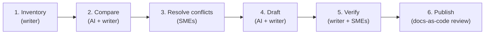

<div className="sample-note">

**Sample type:** Process case study · **Audience:** documentation leads and engineering managers · **Fictional company.** The workflow reflects how I use AI tools in practice; the documents and details are invented.

</div>

**The problem:** Meridian's platform team had ten separate deployment procedures, written by different engineers over three years. They overlapped, contradicted each other in places, and used different names for the same systems. New engineers didn't know which one to follow.

**The goal:** one authoritative deployment procedure, accurate and approved by the people who own the systems.

**The approach:** use an AI assistant for the high-volume reading and comparison, and keep every judgment call, and every fact, with people.

## Workflow



### 1. Inventory: writer

I gathered all ten documents, recorded each one's owner, last-updated date, and the environment it covered, and confirmed with the platform lead which systems were in scope. The AI never decides what's in scope.

### 2. Compare: AI and writer

I asked the assistant to build a comparison table: every step that appears in any document, which documents include it, and where the wording or values differ.

A typical prompt:

```text
Here are ten deployment procedures. Build a table with one
row per distinct step. Columns: step, which documents include
it, and any differences in commands, values, or order. Quote
the exact text for each difference. Do not resolve conflicts
or fill gaps. Mark anything ambiguous as "UNCLEAR".
```

**Why this prompt works:** it asks for extraction, not judgment. Requiring exact quotes makes every row checkable against the source, and the explicit "do not resolve" stops the model from quietly picking a winner.

I spot-checked rows against the originals before relying on the table.

### 3. Resolve conflicts: subject matter experts

The table surfaced 14 conflicts, such as two different rollback commands and three different approval steps. I took them to the system owners as a short list of specific questions. The engineers answered in one 30-minute meeting, because they were deciding, not reading ten documents.

### 4. Draft: AI and writer

With the decisions recorded, I had the assistant produce a first draft that follows our [style guide](style-guide.md): imperative steps, one action per step, a verification after each change. I then rewrote it for flow, added context on why each step matters, and removed anything the decisions didn't support.

### 5. Verify: writer and SMEs

- Every command was checked against the source documents and the SME decisions.
- An engineer who hadn't been involved followed the draft in staging, step by step, and noted every place they hesitated.
- I fixed those spots and had the system owners approve the final text.

### 6. Publish: docs-as-code review

The procedure went through a pull request like any code change, with a reviewer from each owning team. The ten old documents were archived with a pointer to the new one, so links in old tickets still lead somewhere useful.

## Guardrails I apply

| Risk | Guardrail |
| --- | --- |
| The model invents a command or value | Every technical detail must trace to a source document or an SME decision. Nothing ships on the model's word. |
| The model smooths over a real conflict | Prompts require exact quotes and say "do not resolve." Conflicts go to people. |
| Sensitive information leaves the company | Only use tools approved for the data's classification. Sanitize anything that isn't. |
| Fluent text hides gaps | A person who didn't write the draft follows it in a real environment before it's approved. |

## What AI changed, and what it didn't

**It changed** how fast I could read, compare, and produce a first draft. The comparison that would have taken days of side-by-side reading took an afternoon, and the first draft started from structure instead of a blank page.

**It didn't change** who owns the content. Deciding scope, resolving conflicts, verifying accuracy, and approving the result stayed with people. The assistant made the slow parts faster so more time could go to those decisions.
