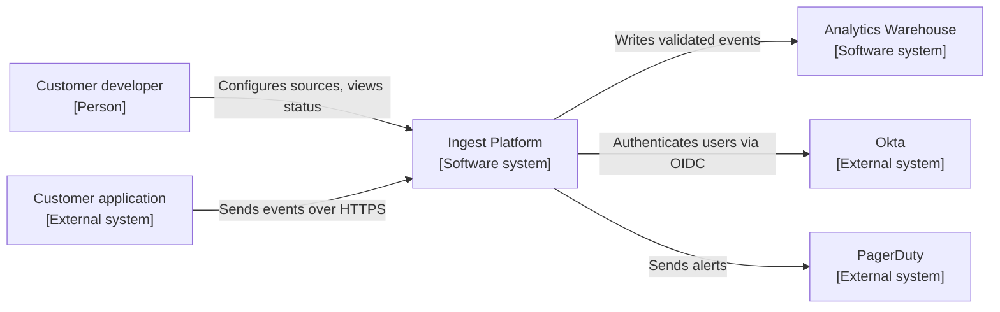
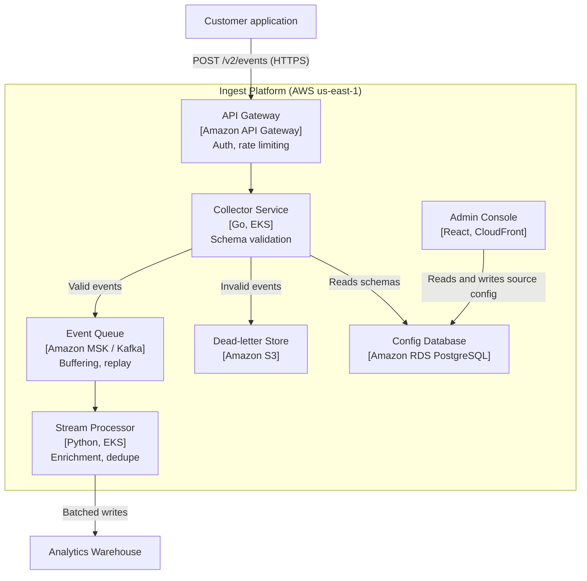

**Sample type:** Architecture overview using the [C4 model](https://c4model.com) · **Audience:** engineers joining the platform team · **Fictional company**

The Ingest Platform collects event data from customer applications, validates it, and makes it queryable within five minutes. This page describes the system at two levels: how it fits into Meridian's wider environment (Context), and the services it is built from (Containers).

## Level 1: System context

| Element | Responsibility | Owner |
| --- | --- | --- |
| Ingest Platform | Receive, validate, and route events | Platform team |
| Analytics Warehouse | Store events and serve queries | Data team |
| Okta | User sign-in for the console | IT |
| PagerDuty | On-call alerting | SRE |

## Level 2: Containers

## Key design decisions

| Decision | Reason | Trade-off accepted |
| --- | --- | --- |
| Validate in the Collector, before the queue | Bad data never reaches the warehouse, and customers get errors immediately | Collector latency rises slightly under heavy schema checks |
| Kafka between collection and processing | Absorbs traffic spikes; events can be replayed after a processor bug | One more system to operate and monitor |
| Invalid events go to S3, not dropped | Support can show customers exactly what was rejected and why | Storage cost, managed with a 30-day lifecycle rule |

## Where to go next

- On-call: [High CPU runbook](runbook-high-cpu.md)
- Integrators: [REST API reference](api-reference.md)
